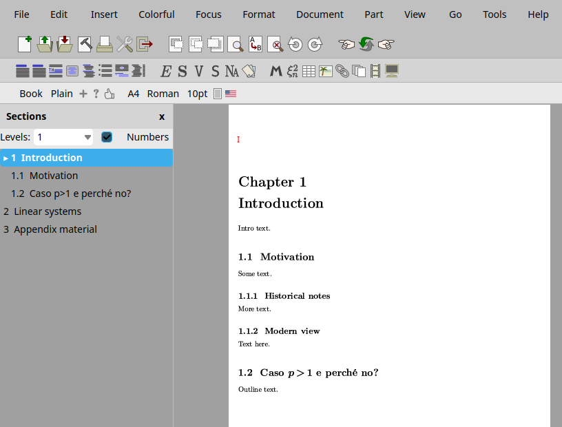
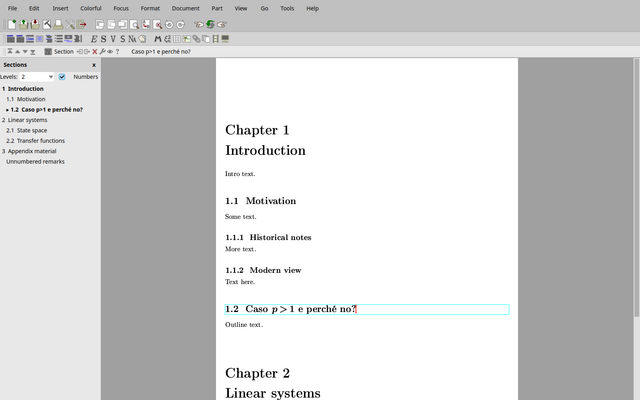

# section-navigator

A GNU TeXmacs plugin that shows the sections of the current document as a tree
in a panel on the left, like the Navigator of LibreOffice: you see where you
are, and you click a heading to go there.



Tested with TeXmacs 2.1.4 (Guile 3) and with TeXmacs trunk 2.1.5 (Guile 1.8,
Qt 5).

## What it does

*View → Section navigator* opens the **Sections** panel in the left side
tools. It stays open in new windows and in later sessions until you close it
(with its `x` or the menu entry again).

- **Tree of headings**: parts, chapters, sections, subsections... down to
  subparagraphs, indented by level.
- **Where you are**: the heading that contains the cursor is marked with ▸
  and is bold, like all the headings above it in the tree.
- **Navigation**: click a heading to move the cursor to its title; the
  document scrolls there.
- **Levels**: how many levels are always shown (1 to 4, or all). The branch
  that contains the cursor is always expanded down to the current heading, so
  level 1 gives a compact outline that follows you through the document.
- **Numbers**: each heading shows its number as in the document (for example
  `7.0.3`), computed with the same rules as TeXmacs: sections inside
  environments (proofs, remarks...) count too, starred sections are
  unnumbered, and paragraphs show no number unless the style numbers them.
  The *Numbers* checkbox turns them off.
- Titles are updated while you type, and new headings appear at once.

Headings are found like in *Focus → Go to section*: the ones inside other
environments are counted for the numbers but are not listed.

On a document with 323 headings an update of the panel costs a few
milliseconds; the numbers are recomputed (about 50 ms) only when the list of
headings changes, and otherwise at most every 10 seconds.

## Installation

Clone the repository, then link (or copy) the `section-navigator` directory
into your TeXmacs plugins directory and restart TeXmacs:

```sh
git clone https://github.com/GliAcopo/texmacs-section-navigator.git
ln -s "$PWD/texmacs-section-navigator/section-navigator" ~/.TeXmacs/plugins/section-navigator
```

Then choose *View → Section navigator*.

## The patched TeXmacs version

The same navigator is written as a patch series for TeXmacs itself, in
[upstream/](upstream/):

1. `Qt: show check marks of side tool buttons, keep side tool scroll
   positions`: the current heading gets the selection color as background,
   and the panel keeps its scroll position and scrolls the current heading
   into view when it is rebuilt (C++, Qt 5 and Qt 6 plugins).
2. `text: section navigator in the left side tools` (Scheme).
3. `text: section numbers in the section navigator` (Scheme).

The patches apply to TeXmacs trunk. A TeXmacs built with them already has the
navigator (`progs/text/text-navigator.scm`): the plugin notices it and does
nothing. Without the first patch, which the plugin cannot provide, the
current heading is shown by ▸ and bold text only, and the panel scrolls back
to the top when the current heading changes.



## Development

This plugin was developed with the assistance of Claude Opus 5.5, an AI model
by Anthropic, used through Claude Code. The design, the code and the tests
were reviewed and verified by the author on TeXmacs 2.1.4 and trunk, including
a comparison of the numbers with those TeXmacs itself gives to all 264
numbered headings of a long document.

## License

Copyright (C) 2026 Jacopo Rizzuto.

This program is free software: you can redistribute it and/or modify it under
the terms of the GNU General Public License as published by the Free Software
Foundation, either version 3 of the License, or (at your option) any later
version. See [LICENSE](LICENSE).
